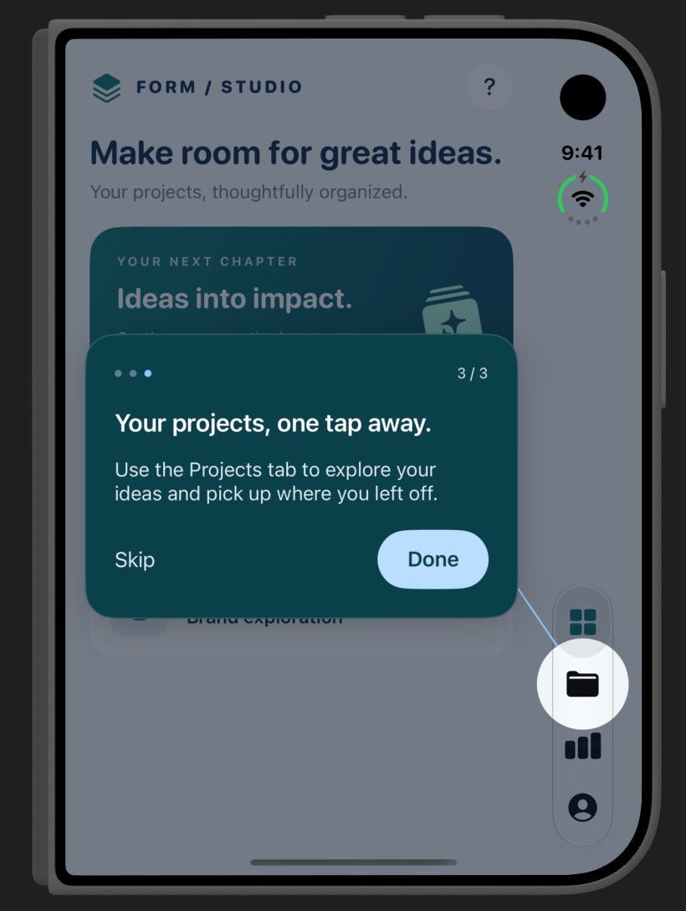
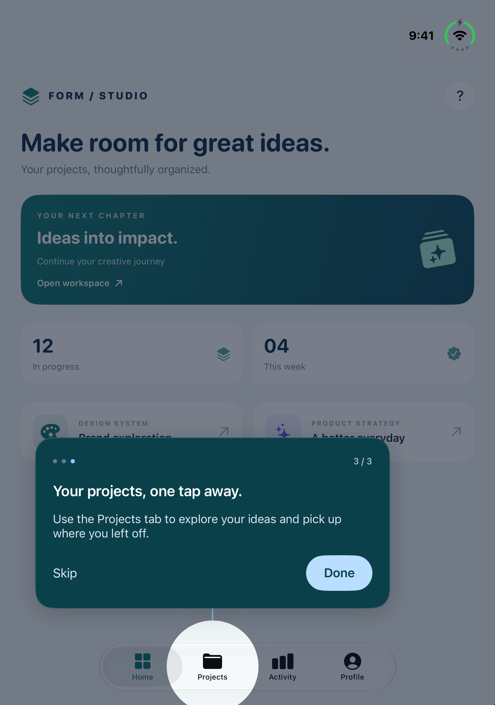
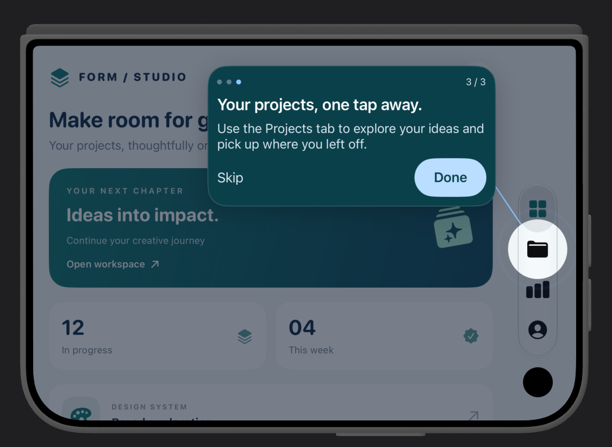
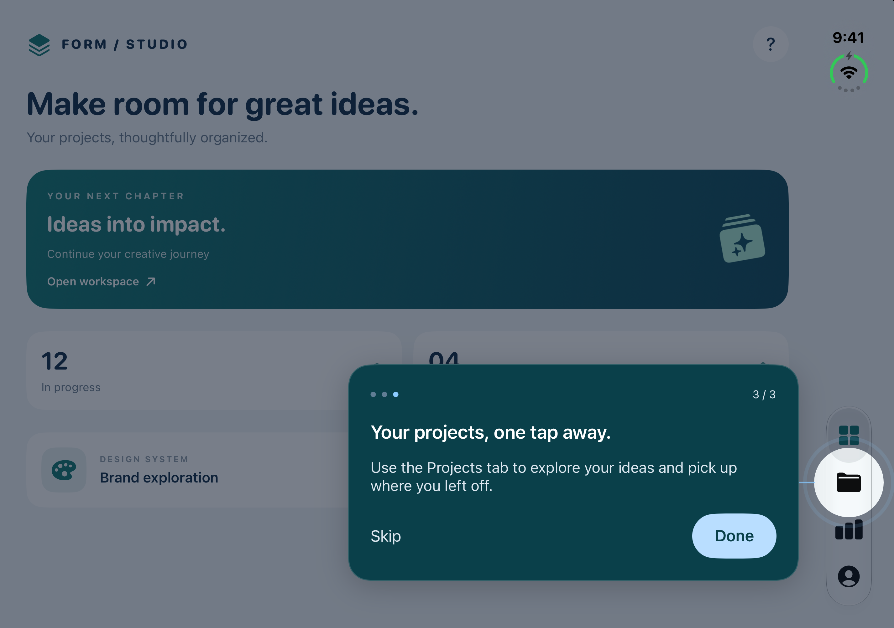
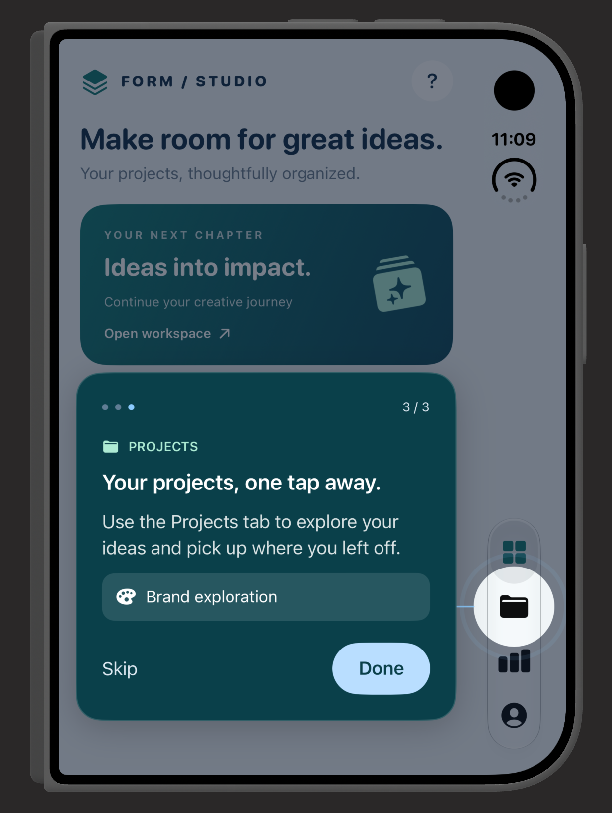
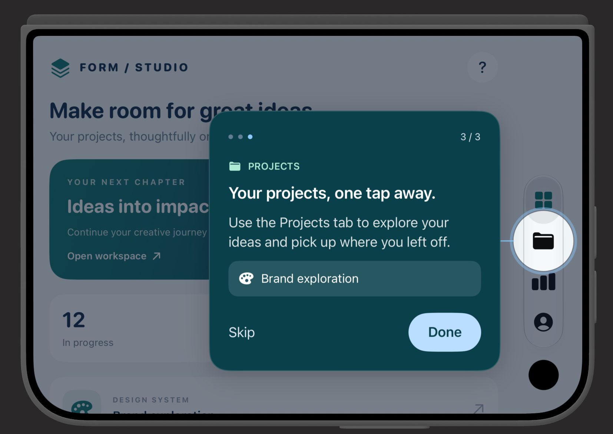

# AdaptiveShowcase

Guide users to the right place in your iOS app with spotlight tutorials for
UIKit and SwiftUI.

AdaptiveShowcase combines a dimmed background, target highlight, connector, and
content-sized popup without third-party dependencies.

- **Custom content:** use the default title/message or supply your own SwiftUI
  body, while the library manages progress and Next/Skip controls.
- **Native tab guides:** highlight actual tab items without guessing positions
  or changing the selected tab.
- **Adaptive placement:** fit the popup around targets and safe areas, with
  scrolling when content exceeds the available space.
- **iPhone Duo support:** adapt to folded/unfolded and portrait/landscape
  layouts, track relocated tab rails, and support mirrored RTL placement.
- **Accessibility and RTL:** support Dynamic Type, Reduce Motion, accessibility
  escape, and right-to-left layout direction.

Requires iOS 15+ and Swift tools 5.9+.
Initial releases are pre-1.0; the API may change between minor versions.

[Install](#installation) | [UIKit](#uikit) | [SwiftUI](#swiftui) |
[Custom content](#custom-body-content) | [Run the demo](#demo-app)

## iPhone Duo gallery

The standalone FORM / STUDIO demo highlights a native SwiftUI `TabView` item
across folded/unfolded and portrait/landscape layouts. No Mawgif screens or
assets are used.

| Folded portrait | Unfolded portrait |
|---|---|
|  |  |

| Folded landscape | Unfolded landscape |
|---|---|
|  |  |

The demo, SwiftUI `tabIndex` steps, `backgroundColor` option, and safe-area/
overflow improvements shown here are included in `0.2.0`.
Version `0.2.1` improves guide tracking during rotation and resizing, resolves
relocated native tab items, and enables automatic signing for the demo app.
Version `0.3.0` adds custom SwiftUI body content for both SwiftUI and UIKit callers.

## Installation

In Xcode, choose **File > Add Package Dependencies** and enter:

```text
https://github.com/sathamkhussain/AdaptiveShowcase.git
```

Select version `0.3.0` or add this dependency to your package:

```swift
.package(
    url: "https://github.com/sathamkhussain/AdaptiveShowcase.git",
    from: "0.3.0"
)
```

Add `"AdaptiveShowcase"` to your target's dependencies.

## UIKit

Keep a reference to the overlay while it is being presented. Use it on the main
thread after the screen has appeared.

```swift
import UIKit
import AdaptiveShowcase

final class ExampleViewController: UIViewController {
    private let detailsButton = UIButton(type: .system)
    private var guide: ShowcaseOverlayView?

    func showGuide() {
        guard guide == nil, view.window != nil else { return }

        let overlay = ShowcaseOverlayView(
            configuration: .init(
                title: "Details",
                message: "Find more information here.",
                nextTitle: "Done",
                skipTitle: "Skip",
                highlightShape: .roundedRectangle
            ),
            targetRect: { [weak self] overlay in
                guard let button = self?.detailsButton,
                      button.window === overlay.window,
                      !button.isHidden, !button.bounds.isEmpty else {
                    return nil
                }
                return button.convert(button.bounds, to: overlay)
            },
            completion: { [weak self] reason in
                self?.guide = nil
                // Advance or save tutorial completion in your app.
            }
        )
        guide = overlay
        overlay.show(in: view, parent: self)
    }
}
```

Add and lay out `detailsButton` in your screen before calling `showGuide()`.
The target closure returns a rectangle in **overlay coordinates** and is
reevaluated during layout. Scroll off-screen targets into view before showing
their step. For a group, return the union of the views' converted bounds.

To cancel an active guide, call `guide?.dismiss(.cancelled)`. Each overlay is
single-use. Create a new one for the next step or replay.

### Tab items and system containers

Use circular tab highlights without guessing tab positions:

```swift
let configuration = ShowcaseOverlayView.Configuration(
    title: "Vehicles",
    message: "Manage your vehicles here.",
    highlightShape: .circle,
    rippleEnabled: true
)

// Use this in your overlay's targetRect closure:
ShowcaseOverlayView.tabItemRect(
    in: tabController.tabBar,
    at: 2,
    convertedTo: overlay
)
```

If you pass a tab or navigation controller as `parent`, the library presents a
transparent full-screen host above it instead of adding managed tab/navigation
entries. The presenting controller must be visible and not already presenting
another controller.

If your screen cancels its guide in `viewWillDisappear`, exclude the library's
own presentation:

```swift
override func viewWillDisappear(_ animated: Bool) {
    super.viewWillDisappear(animated)
    let presented = tabBarController?.presentedViewController
        ?? navigationController?.presentedViewController
        ?? presentedViewController
    if guide?.ownsPresentation(presented) == true { return }
    guide?.dismiss(.cancelled)
}
```

Avoid restarting a tutorial in `viewDidAppear` while an existing guide is active.

### Configuration and completion

UIKit configuration supports title/message fonts, button labels, highlight
shape/padding, optional ripple, progress (`step` is one-based), and
`layoutDirection`. Supply localized strings from your app. For Arabic UIKit
screens, pass `layoutDirection: .rightToLeft`.

The popup defaults to a blue palette. Set `backgroundColor` in UIKit
configuration or a SwiftUI `ShowcaseStep` to customise its background; choose
a dark colour to retain contrast with the light text and buttons. The legacy
`color` parameter is retained for compatibility but does not style the popup.

The dimmed overlay covers safe areas; popup placement still respects them.
If even compact spacing cannot fit the popup beside its target, the entire
popup scrolls, including progress and actions, instead of squeezing its text.

## Demo app

Open `Examples/ShowcaseDemo/ShowcaseDemo.xcodeproj` and run the `ShowcaseDemo`
scheme. The unbranded FORM / STUDIO example uses a native SwiftUI `TabView`
and the SwiftUI showcase API to highlight dashboard cards and the Projects
tab. The guide uses custom labels and a project preview in the tab step.
Tap **?** to replay,
or add `--show-guide` to the scheme's launch arguments to start automatically.
For a native SwiftUI `TabView`, use a zero-based tab index:

```swift
ShowcaseStep(
    tabIndex: 1,
    title: "Projects",
    message: "Your projects, one tap away.",
    nextTitle: "Done"
)
```

Attach `.showcase` inside a tab's content so it can find the enclosing UIKit
tab controller. The step uses the native tab item's actual frame and defaults
to a circular highlight with ripple. It waits if the controller or item is
unavailable; it never estimates tab positions. Do not attach `.showcaseTarget`
to `tabItem` labels.

To regenerate the project, run `ruby Examples/ShowcaseDemo/generate_project.rb`
with the `xcodeproj` Ruby gem available.

### Custom body content

The demo's Projects step includes a custom folder label and project preview,
with library-managed progress and Skip/Done controls:

| Duo portrait | Duo landscape |
|---|---|
|  |  |

Pass a SwiftUI view builder to replace the title and message for each step:

```swift
.showcase(isPresented: $showGuide, steps: steps) { step in
    VStack(alignment: .leading, spacing: 12) {
        Label("Discover", systemImage: "sparkles")
        Text(step.title).font(.headline).accessibilityAddTraits(.isHeader)
        Text(step.message)
        if step.tabIndex != nil {
            Label("Your saved projects", systemImage: "folder")
        }
    }
    .foregroundStyle(.white)
}
```

For UIKit, use the same SwiftUI content through the overlay initializer:

```swift
let overlay = ShowcaseOverlayView(
    configuration: .init(title: "Projects", message: "Your saved work."),
    targetRect: { targetView.convert(targetView.bounds, to: $0) },
    completion: { _ in }
) {
    VStack(alignment: .leading, spacing: 12) {
        Image(systemName: "folder.fill")
        Text("Your projects").font(.headline)
        Text("Everything you need, in one place.")
    }
    .foregroundStyle(.white)
}
```

Progress, Next/Skip buttons, background styling, spotlight and connector remain
library-managed. Existing title/message-only calls are unchanged, and steps
remain `Equatable`. Custom content updates without restarting the current step.

Use content-sized views rather than unbounded `GeometryReader`s or expanding
`Spacer`s. The body is measured and scrolls when space is limited; changes to its
natural height trigger remeasurement. Content may also be instantiated for
off-screen measurement, so keep view construction free of side effects and
share model state when needed. Wrap UIKit views with `UIViewRepresentable`,
creating a separate view instance in each `makeUIView` call.

Custom content inherits layout direction (including Arabic RTL) and supports
the existing adaptive layout on iOS 15+, iPhones, Duo and iPads. Use leading/
trailing alignment, scalable fonts and accessible labels in your own content.

Completion reasons:

| Reason | Meaning |
|---|---|
| `.next` | Next/Done or a background tap |
| `.skipped` | Skip or accessibility escape |
| `.cancelled` | Explicit cancellation or external host dismissal |
| `.unavailable` | Target cannot be resolved or system-container presentation is unavailable |

The app owns tutorial order, first-use persistence, and replay behaviour.

## SwiftUI

Mark each target with a unique ID and attach the tutorial modifier to a common
ancestor covering the screen:

```swift
import SwiftUI
import AdaptiveShowcase

struct ExampleScreen: View {
    @State private var showGuide = false

    var body: some View {
        VStack(spacing: 32) {
            Button("Details") {}
                .showcaseTarget("details")
            Button("Settings") {}
                .showcaseTarget("settings")
            Button("Show guide") { showGuide = true }
        }
        .frame(maxWidth: .infinity, maxHeight: .infinity)
        .showcase(isPresented: $showGuide, steps: [
            ShowcaseStep(
                target: "details",
                title: "Details",
                message: "Find more information here."
            ),
            ShowcaseStep(
                target: "settings",
                title: "Settings",
                message: "Manage your preferences.",
                nextTitle: "Done",
                highlightShape: .circle
            )
        ])
    }
}
```

Next advances the array; Done and Skip set the binding to `false`. Setting the
binding to `false` cancels presentation. SwiftUI inherits environment layout
direction; use `.environment(\.layoutDirection, .rightToLeft)` for RTL previews.

A step waits for its target to become visible. The app must scroll lazy/off-screen
targets into view. Attach the modifier inside the appropriate sheet or navigation
screen; targets do not cross presentation/window boundaries. Updating the steps
array restarts the sequence. The SwiftUI step API currently exposes text, labels
and shape, not all UIKit styling options.

## Adaptive layout and accessibility

Geometry uses container bounds and actual target positions, not physical screen
size estimates. The popup respects the host's safe area, reduces padding and gaps
when space is limited, and scrolls text when required. Side-rail targets can use
full-height space beside the rail even on compact-width devices; the popup grows
to its natural content height, capped by the chosen safe-area placement region.
Dynamic Type, Reduce Motion,
and accessibility escape are supported. Extremely small placement regions may
not accommodate a usable panel; avoid targeting an entire screen-sized region.

## Testing

Open `Package.swift` in Xcode, select the AdaptiveShowcase scheme and a specific
iOS simulator, then choose **Product > Test** (`Command-U`).

From Terminal:

```bash
xcodebuild -scheme AdaptiveShowcase \
  -destination 'platform=iOS Simulator,id=<simulator-udid>' test
```

Tests require an iOS simulator; `swift test` on macOS cannot build UIKit.
Validate custom app targets visually on compact/wide layouts and RTL as well.
The hostless package runner has no window scene: modal lifecycle unit tests drive
appearance transitions with a test presenter. They do not replace app-hosted
verification of UIKit presentation/dismissal or navigation interruptions.

## Licence

MIT. See [LICENSE](LICENSE).
